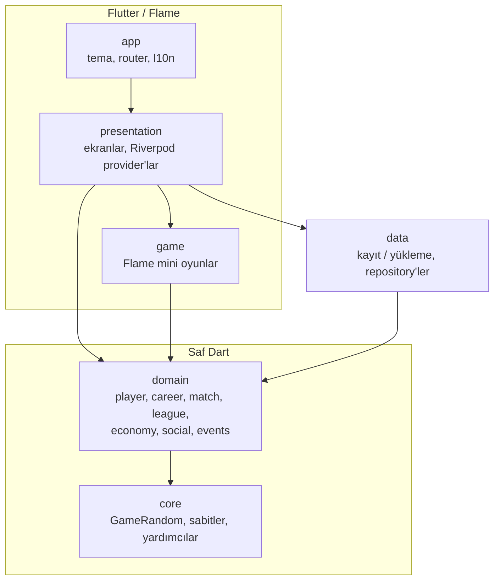
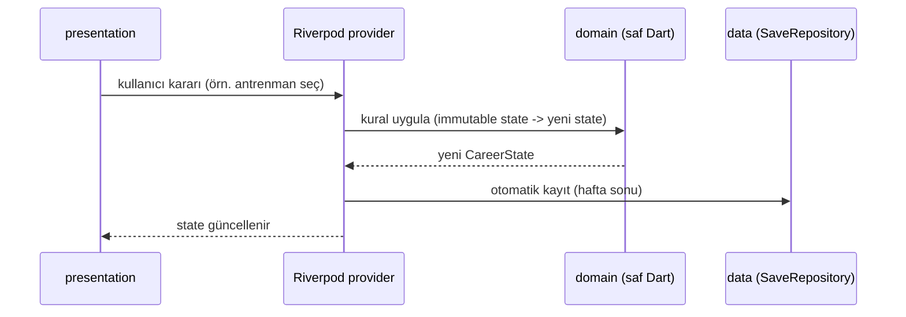

# Mimari

## Katmanlar

## Kurallar

- Oklar yalnızca aşağı doğru: `domain` ve `core` hiçbir üst katmanı bilmez.
- `domain` / `core` içinde `flutter`, `flame`, `flutter_riverpod`, `go_router` import edilemez (`test/architecture_test.dart`).
- Rastgelelik yalnızca `GameRandom` ile gelir; seed verilebilir.

## Veri akışı (hedef, Faz 1+)

Mini oyunlar (Faz 3+): `domain/match` kritik an üretir → `game/` Flame sahnesi oynanır → `ShotResult` gibi basit bir sonuç nesnesi domain'e döner.

## Kulüp sistemi (Faz 6)

- `CareerState` artık `worldSeed`, `contract` (null = serbest oyuncu), `agent`, `finance`, `offers`, `results` taşır; kayıt şeması 4.
- `WeekEngine.advance` hafta sonunda sırasıyla: antrenman/durum -> para (`Economy.weekly`) -> skor kaydı -> `ClubEngine.process` (sezon geçişi, süresi dolan teklifler, yenileme, yeni teklifler).
- `ClubWorld` (lig piramidi + fikstür) ve `LeagueTable` (deterministik puan durumu) `domain/league/` içinde; UI'da `clubWorldProvider` ile paylaşılır.
- Kulüp aksiyonları (`TransferMarket.sign`, `ClubActions.*`) saf fonksiyonlardır; `ActiveCareerNotifier` yalnızca çağırıp kaydeder.
